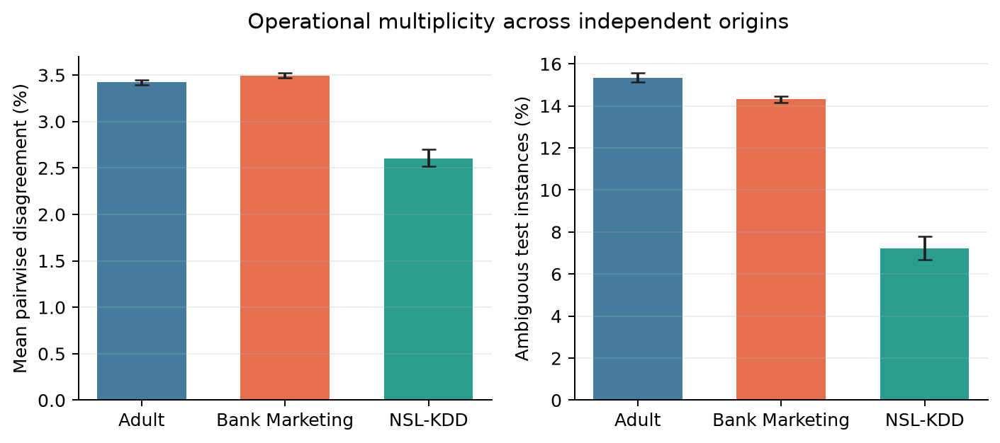
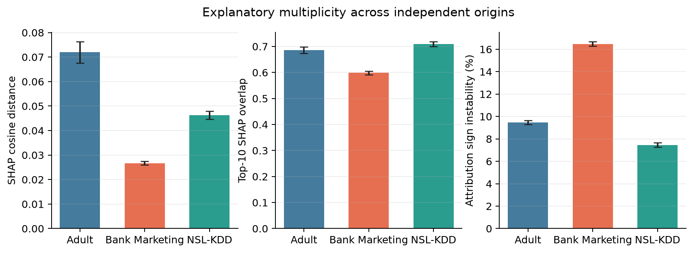
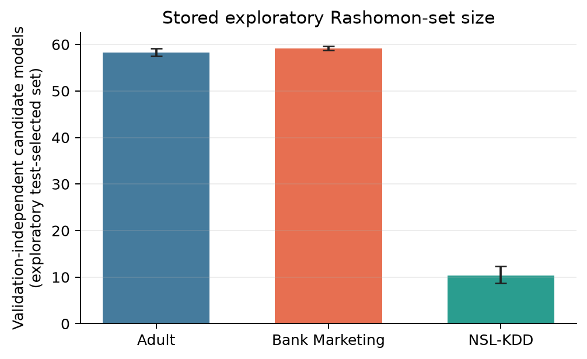

<!-- Author: Coda -->
# Preliminary results report: model multiplicity across classification tasks

**Status:** exploratory report based on the shared Drive artifacts, 23 October
2026. It is suitable for deciding whether to pursue the paper story and for a
lab/internal presentation. It is **not** a final confirmatory paper result:
the stored run selected the Rashomon set by test accuracy. We are reconstructing
validation metrics from the saved checkpoints before producing the final version.

## Design

For each dataset, ten independent origin runs were aggregated. The uncertainty
intervals are percentile 95% bootstrap CIs over origin-level means (2,000
resamples). Model pairs and individual test samples were not treated as
independent observations.

The stored analysis compares models within a 1% accuracy tolerance of the best
model. Decision multiplicity is measured by pairwise prediction disagreement
and the share of samples on which the models conflict. Explanation multiplicity
is measured with mean absolute-SHAP cosine distance, top-10 feature-set
Jaccard overlap, and attribution-sign instability.

**Figure 1.** Operational multiplicity remains visible across all three
datasets. Roughly 2.60--3.49% of test decisions differ between similarly
performing models; 7.24--15.35% of samples have at least one conflicting vote.

**Figure 2.** Explanatory conclusions are less stable than a single global
importance vector would suggest. In particular, Bank Marketing has the lowest
SHAP-cosine distance yet the lowest top-10 feature overlap (0.598) and the
highest sign instability (16.45%). No single explanation-stability metric is
therefore sufficient.

**Figure 3.** The number of near-optimal models differs markedly by dataset:
about 58--59 models in Adult/Bank Marketing, versus 10.4 in NSL-KDD. The
effect is therefore not simply caused by sampling a fixed number of models.

## Main results

| Dataset | Origins | Rashomon models | Ambiguity | Decision disagreement | Top-10 SHAP overlap | Sign instability |
|---|---:|---:|---:|---:|---:|---:|
| Adult | 10 | 58.3 [57.5, 59.1] | 15.35% [15.13, 15.55] | 3.42% [3.39, 3.45] | 0.686 [0.673, 0.698] | 9.47% [9.29, 9.65] |
| Bank Marketing | 10 | 59.1 [58.7, 59.6] | 14.31% [14.14, 14.48] | 3.49% [3.47, 3.52] | 0.598 [0.592, 0.605] | 16.45% [16.27, 16.66] |
| NSL-KDD | 10 | 10.4 [8.7, 12.3] | 7.24% [6.70, 7.81] | 2.60% [2.52, 2.70] | 0.709 [0.700, 0.718] | 7.45% [7.26, 7.68] |

## Interpretation and paper story

The results support one focused claim: **models that are similarly accurate
need not be operationally or explanatorily interchangeable.** The effect
replicates across three datasets and two different dimensions:

- Model choice changes predictions for a non-trivial subset of instances.
- Model choice also changes the salient features and sometimes the direction
  of their contribution.

For a cyber-defense paper, NSL-KDD should be the security-focused case study:
the final Results section should split conflict samples into attack/normal and
false-positive/false-negative categories, then show whether explanatory
instability is strongest on those operationally costly cases. Adult and Bank
Marketing are valuable replication datasets, not the central application
claim.

## What changes in the final report

The saved models and dataset caches allow us to reconstruct validation metrics
without retraining. We will then select the Rashomon set on validation
accuracy, regenerate decision and SHAP analyses strictly for that membership,
and replace the three figures above with their confirmatory counterparts.
